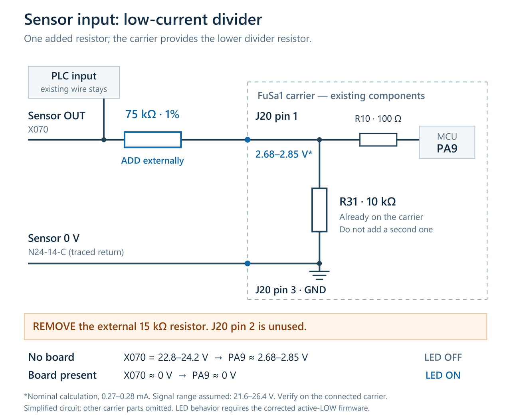

# Proposed low-current sensor input divider

[Vector schematic (SVG)](sensor_divider_75k.svg) | [Drawing source](draw_sensor_divider.py)

The proposed circuit uses one external **75 kΩ, 1%** resistor from the sensor output to **J20 pin 1**. **Remove the external 15 kΩ resistor.** Existing carrier **R31 = 10 kΩ** supplies the lower divider leg to **J20 pin 3 / sensor 0 V**. Do not add another 10 kΩ resistor. Preserve the original sensor-to-PLC connection; J20 pin 2 is unused.

With the carrier connected, nominal calculations give:

| Sensor output | GPIO voltage | Added divider current |
| --- | ---: | ---: |
| 22.8 V | 2.68 V | 0.27 mA |
| 24.2 V | 2.85 V | 0.28 mA |

The corrected firmware interprets LOW as board present (`ON`, warning LED on) and HIGH as no board (`OFF`, warning LED off). Existing R10 = 100 Ω connects the header node to PA9. Other carrier filtering/protection parts are omitted from this simplified drawing.

This circuit is proposed, not physically qualified. The calculation assumes a steady signal range of 21.6–26.4 V and a fitted R31. Confirm actual carrier values, shared 0 V, signal limits and connected HIGH/LOW voltages before use. The exact Keyence sensor model/output rating remains unidentified. Do not apply 24 V directly to J20.

To regenerate the PNG and SVG, run `python draw_sensor_divider.py` on Windows with Pillow and the Segoe UI fonts installed.
